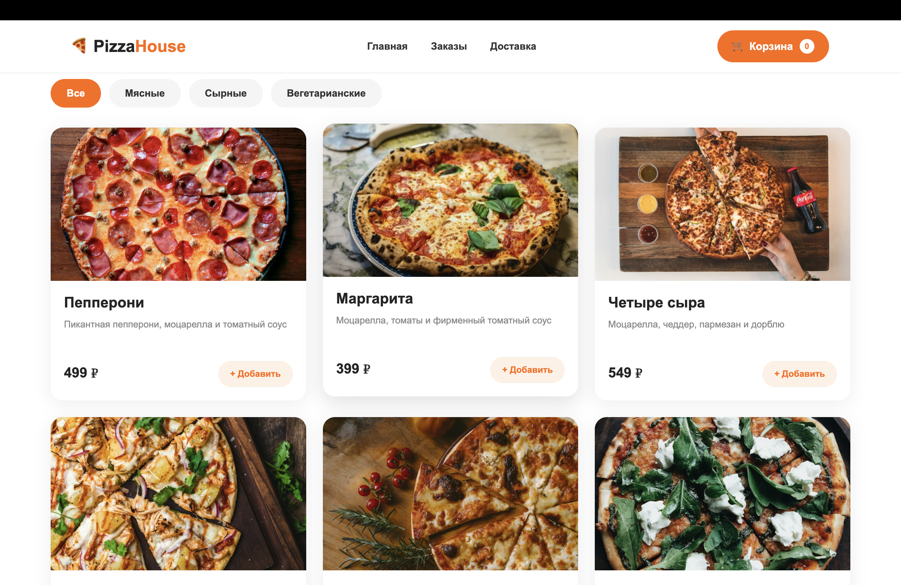
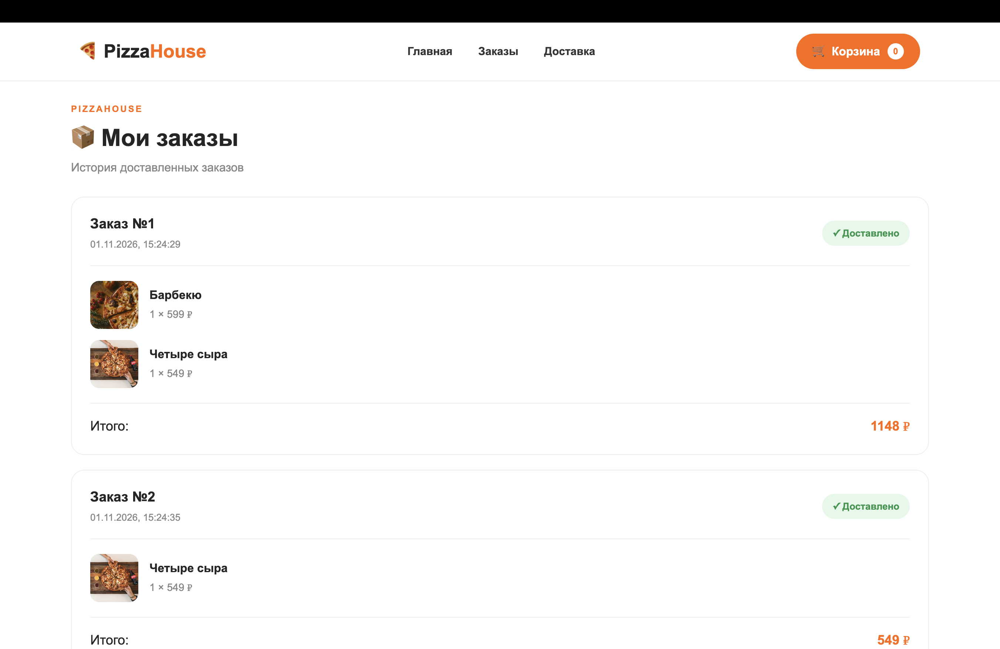

# React Pizza

A modern and elegant wedding invitation website built with React. The application provides a beautiful digital invitation where guests can explore wedding details, view the event schedule, find the venue, and confirm their attendance.

## 🚀 Live Demo

**Live Demo**: [React Pizza URL](https://react-pizza-seven-omega.vercel.app/)

Repository: [GitHub repository URL](https://github.com/DaddySammyLabs/react-pizza)

## 📸 Preview




## Основные возможности проекта

### 🍕 Pizza Catalog — каталог пиццы.

- Displaying pizzas with images, descriptions, and prices.
- Filtering pizzas by categories.
- Highlighting popular pizzas.
- Loading and error states.

### 🛒 Shopping Cart — корзина покупок.

- Adding pizzas to the cart.
- Increasing and decreasing product quantities.
- Removing individual products.
- Calculating the total number of items.
- Calculating the total price.
- Clearing the shopping cart.
- Synchronizing cart data with the server.

### 📦 Order Management — управление заказами.

- Creating new orders.
- Saving orders on the server.
- Managing order information.
- Viewing order history.
- Preventing duplicate order processing.

### 🚚 Delivery System — система доставки.

- Displaying active delivery orders.
- Automatic delivery status checking.
- Simulated delivery time.
- Automatically transferring completed orders to order history.
- Updating delivery information.

### ✨ Features

- 🍕 Browse the pizza catalog.
- 🔎 Filter pizzas by category.
- 🔥 Highlight popular pizzas.
- 🛒 Add and remove products from the shopping cart.
- ➕ Increase product quantity.
- ➖ Decrease product quantity.
- 🧹 Clear the shopping cart.
- 💰 Calculate the total cart price.
- 📦 Create and manage orders.
- 🚚 Track active deliveries.
- 🔄 Automatically process completed deliveries.
- 📋 View order history.
- 🌙 Switch between light and dark themes.
- 🌐 Multilingual interface.
- ⏳ Loading and error states.
- 📱 Responsive layout for different screen sizes.
- 🧩 Reusable React components.

## 🛠️ Tech Stack

### ⚛️ Core

- **React**
- **JavaScript (ES6+)**
- **Vite**
- **React Router**

### 🎨 Styling

- **CSS Modules**
- **Global CSS**

### 🧠 State & Logic

**React Hooks**
**Context API**
**Custom Hooks**
**useState**
**useEffect**
**useCallback**
**useRef**

### 🌐 API & Data Fetching

**Axios**
**REST API**
**AbortController**

### 📦 Backend

**Mokky.dev — backend service for storing and managing application data.**

---

## 🧠 Architecture

The application is organized around reusable components and custom hooks.

The main goal was to keep UI components focused on presentation while moving reusable business logic into separate hooks.

```
User Interaction
        │
        ▼
    React Components
        │
        ▼
     AppContext
        │
        ▼
    useAppState
        │
        ├── useLanguage
        ├── useTheme
        ├── useCategories
        ├── useCart
        └── useOrders
        │
        ▼
    Axios API Layer
        │
        ▼
      Mokky.dev

```

## Application State

useAppState.js acts as a central layer that combines different pieces of application logic.

Instead of keeping all logic inside App.jsx, functionality is divided between specialized hooks.

For example:

```
useAppState
├── useLanguage
├── useTheme
├── useCategories
├── useCart
└── useOrders

```

## 📁 Project Structure

```
src/
├── api/
│   └── ...
│
├── assets/
│   └── styles/
│       └── App.module.css
│
├── components/
│   ├── screens/
│   │   ├── header/
│   │   └── hero/
│   │
│   └── ui/
│       ├── categories/
│       └── pizza-card/
│
├── context/
│   └── AppContext.jsx
│
├── hooks/
│   ├── api/
│   │   ├── useCart.js
│   │   └── useFetch.js
│   │
│   ├── providers/
│   │   ├── useLanguage.js
│   │   └── useTheme.js
│   │
│   ├── useAppState.js
│   ├── useCategories.js
│   └── useOrders.js
│
├── pages/
│   ├── home/
│   │   └── Home.jsx
│   │
│   ├── cart/
│   │   └── CartPage.jsx
│   │
│   ├── delivery/
│   │   └── DeliveryPage.jsx
│   │
│   └── orders/
│       └── OrdersPage.jsx
│
├── App.jsx
└── main.jsx

public/
└── ...

```

### 💻 Installation

Clone the repository:

git clone https://github.com/DaddySammyLabs/pizza-shop.git

Navigate to the project:

`cd react-sneaker-store`

Install dependencies:

`npm install`

Start the development server:

`npm run dev`

Build the project for production:

`npm run build`

## 👨‍💻 About

This project is part of my frontend development portfolio.

I built it to gain practical experience with React architecture, state management, custom hooks, routing, reusable components, and interactive UI development.

The main focus was not only on making the interface work, but also on learning how to organize application logic into independent and reusable parts.
