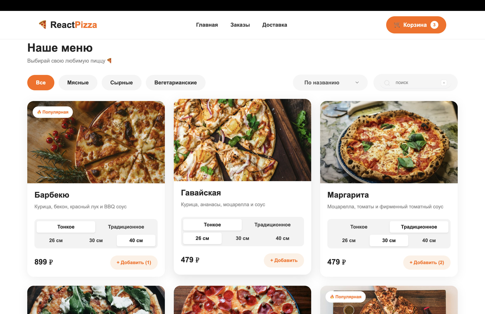
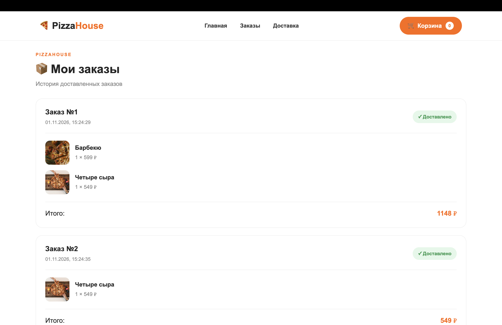

# 🍕 Greenlights. Pizza Shop

A modern pizza ordering web application built with React 19 and Vite.

Explore the pizza catalog, customize your shopping cart, place orders, track deliveries, and manage your order history — all through a responsive and user-friendly interface.

<p align="center">
<a href="https://react-pizza-seven-omega.vercel.app/">
<strong>🚀 Live Demo</strong>
</a>
&nbsp;·&nbsp;
<a href="https://github.com/DaddySammyLabs/react-pizza">
<strong>📂 GitHub Repository</strong>
</a>
</p>

## 📸 Preview




### ✨ Features

- 🍕 Browse pizzas with images, descriptions, and prices.
- 🔎 Filter products by category.
- 🔥 Discover popular pizzas.
- 🎯 Handle loading and error states.
- 🛒 Add and remove products from the shopping cart.
- ➕ Increase product quantity.
- ➖ Decrease product quantity.
- 🧹 Clear the shopping cart.
- 💰 Calculate the total cart price.
- 📦 Create and manage orders.
- 🚚 Track active deliveries.
- 🔄 Automatically process completed deliveries.
- 📋 View order history.
- 🌙 Switch between light and dark themes.
- 🌐 Multilingual interface.
- ⏳ Loading and error states.
- 📱 Responsive layout for different screen sizes.
- 🧩 Reusable React components.

### 🍕 Pizza Catalog — каталог пиццы.

- Displaying pizzas with images, descriptions, and prices.
- Filtering pizzas by categories.
- Highlighting popular pizzas.
- Loading and error states.

### 🛒 Shopping Cart — корзина покупок.

- Adding pizzas to the cart.
- Increasing and decreasing product quantities.
- Removing individual products.
- Calculating the total number of items.
- Automatically calculate the total price.
- Clearing the shopping cart.
- Synchronizing cart data with the server.

### 📦 Order Management — управление заказами.

- Creating new orders.
- Saving orders on the server.
- Managing order information.
- Viewing order history.
- Preventing duplicate order processing.

### 🚚 Delivery System — система доставки.

- View active delivery orders.
- Check delivery status automatically.
- Display simulated delivery time.
- Automatically transferring completed orders to order history.
- Updating delivery information.

### 🎨 User Experience

- Responsive design for different screen sizes.
- Light and dark themes.
- Multilingual interface.
- Smooth UI animations.
- Reusable React components.
- Loading and error handling.
- Updating delivery information.

## 🛠️ Tech Stack

### ⚛️ Core

- **React**
- **JavaScript (ES6+)**
- **Vite**
- **React Router**

### 🎨 Styling

- **CSS Modules**
- **Global CSS**
- **@formkit/auto-animate**

### 🧠 State & Logic

**React Hooks**
**Context API**
**Custom Hooks**
**useState**
**useEffect**
**useCallback**
**useRef**

### 🌐 API & Data Fetching

**Axios**
**REST API**
**AbortController**

### 📦 Backend

**Mokky.dev — backend service for storing and managing application data.**

---

## 🧠 Architecture

The application follows a component-based architecture with a clear separation between UI components, application state, business logic, and API communication.

The main goal is to keep components focused on presentation while moving reusable logic into custom hooks.

### Application Flow

```
User Interaction
        │
        ▼
    React Components
        │
        ▼
     AppContext
        │
        ▼
    useAppState
        │
        ├── useLanguage
        ├── useTheme
        ├── useCategories
        ├── useCart
        └── useOrders
        │
        ▼
    Axios API Layer
        │
        ▼
      Mokky.dev

```

## Application State

useAppState.js acts as a central layer that combines different pieces of application logic.

Instead of keeping all logic inside App.jsx, functionality is divided between specialized hooks.

For example:

```
useAppState
├── useLanguage — manages application language.
├── useTheme - manages light and dark themes.
├── useCategories — handles pizza categories.
├── useCart — manages shopping cart operations.
└── useOrders — handles order management and delivery logic.

```

## 📁 Project Structure

```
react-pizza/
│
├── public/
│
├── src/
│   ├── api/
│   │
│   ├── assets/
│   │   └── styles/
│   │       └── App.module.css
│   │
│   ├── components/
│   │   ├── screens/
│   │   │   ├── header/
│   │   │   └── hero/
│   │   │
│   │   └── ui/
│   │       ├── categories/
│   │       └── pizza-card/
│   │
│   ├── context/
│   │   └── AppContext.jsx
│   │
│   ├── hooks/
│   │   ├── api/
│   │   │   ├── useCart.js
│   │   │   └── useFetch.js
│   │   │
│   │   ├── providers/
│   │   │   ├── useLanguage.js
│   │   │   └── useTheme.js
│   │   │
│   │   ├── useAppState.js
│   │   ├── useCategories.js
│   │   └── useOrders.js
│   │
│   ├── pages/
│   │   ├── home/
│   │   │   └── Home.jsx
│   │   │
│   │   ├── cart/
│   │   │   └── CartPage.jsx
│   │   │
│   │   ├── delivery/
│   │   │   └── DeliveryPage.jsx
│   │   │
│   │   └── orders/
│   │       └── OrdersPage.jsx
│   │
│   ├── App.jsx
│   └── main.jsx
│
├── .gitignore
├── eslint.config.js
├── index.html
├── jsconfig.json
├── package.json
├── package-lock.json
└── vite.config.js


```

## 🚀 Getting Started

### 💻 Installation

Clone the repository:

`git clone https://github.com/DaddySammyLabs/pizza-shop.git`

Navigate to the project:

`cd react-sneaker-store`

Install dependencies:

`npm install`

Start the development server:

`npm run dev`

Build the project for production:

`npm run build`

## 👨‍💻 About

This project is part of my frontend development portfolio.

I built it to gain practical experience with React architecture, state management, custom hooks, routing, reusable components, and interactive UI development.

The main focus was not only on making the interface work, but also on learning how to organize application logic into independent and reusable parts.
